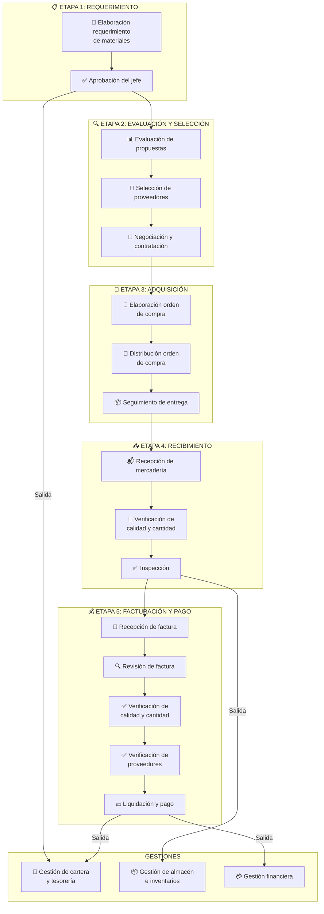

# PROCESO DE COMPRAS - Diagrama de Flujo

---

## Versión Simple - Lista de Pasos

### ETAPA 1: REQUERIMIENTO
1. Elaboración de requerimiento de materiales
2. Aprobación del jefe

### ETAPA 2: EVALUACIÓN Y SELECCIÓN
1. Evaluación de propuestas
2. Selección de proveedores
3. Negociación y contratación

### ETAPA 3: ADQUISICIÓN
1. Elaboración orden de compra
2. Distribución orden de compra
3. Seguimiento de entrega

### ETAPA 4: RECIBIMIENTO
1. Recepción de mercadería
2. Verificación de calidad y cantidad
3. Inspección

### ETAPA 5: FACTURACIÓN Y PAGO
1. Recepción de factura
2. Revisión de factura
3. Verificación de calidad y cantidad
4. Verificación de proveedores
5. Liquidación y pago

---

## Gestiones de Soporte
- **Gestión de cartera y tesorería** → Flujo desde Etapa 1 y Etapa 5
- **Gestión de almacén e inventarios** → Flujo desde Etapa 4
- **Gestión financiera** → Flujo desde Etapa 5
